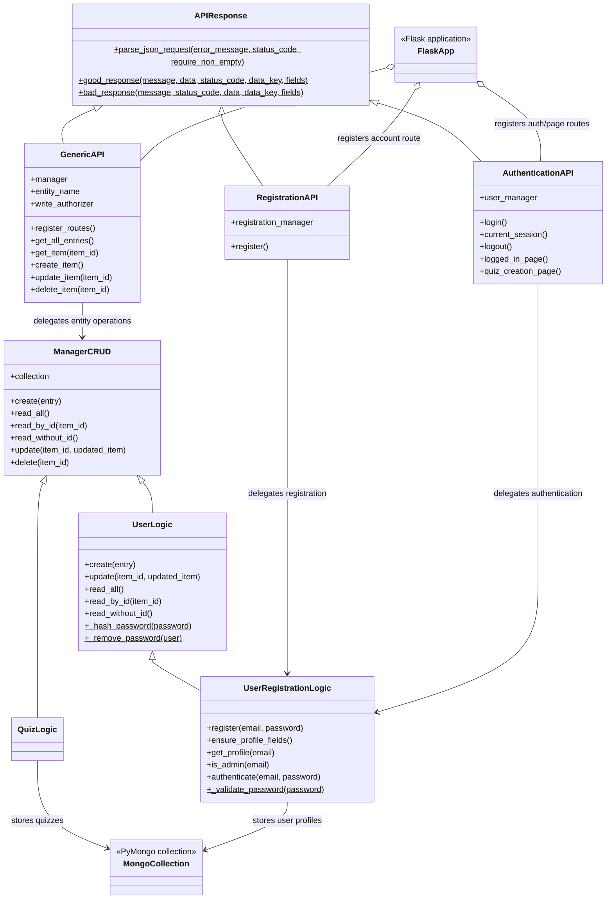
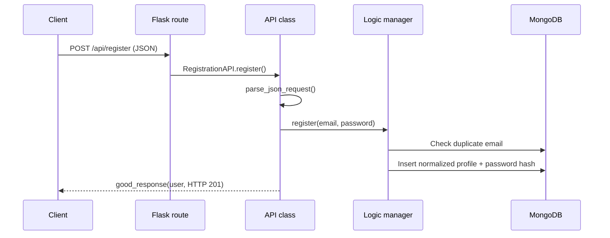

# Python Backend Guide

This guide describes the Python/Flask and MongoDB backend only. Browser templates,
styles, and JavaScript implementation details are intentionally out of scope.

## Package map

| Module | Responsibility |
| --- | --- |
| `backend/server.py` | Creates the Flask application, configures MongoDB and sessions, initializes managers and APIs, and defines authorization policy. |
| `backend/logic/api_response.py` | Shared JSON request parsing and success/error response helpers. |
| `backend/logic/generic_api.py` | Generic entity CRUD routes and optional write authorization. |
| `backend/logic/registration_api.py` | Account registration endpoint and registration-specific error mapping. |
| `backend/logic/authentication_api.py` | Login, logout, current-session, and protected page routes. |
| `backend/logic/generic_crud.py` | MongoDB-backed create, read, update, and delete operations. |
| `backend/logic/user_logic.py` | User CRUD behavior and password hashing/removal. |
| `backend/logic/user_registration.py` | Email/password validation, registration, authentication, profile lookup, and admin-role lookup. |
| `backend/logic/quiz_logic.py` | Quiz-specific manager, currently inheriting generic MongoDB CRUD operations. |

## Class diagram



## Request and response conventions

`APIResponse` is the common base class for JSON APIs:

- `parse_json_request(...)` reads JSON with Flask's silent parser and accepts only
  JSON objects. It returns `(data, None)` on success or `(None, Flask response)`
  on invalid input.
- Set `require_non_empty=True` for operations where an empty object is not useful,
  such as generic create and update routes.
- `good_response(...)` and `bad_response(...)` return a JSON body with a boolean
  `success` field and a human-readable `message`. Callers can include named data
  fields and choose an HTTP status code.
- Generic CRUD responses use entity-specific keys such as `quiz` or `quizzes`.
  Registration and authentication responses use `user`.

Example successful response:

```json
{
  "success": true,
  "message": "Login successful.",
  "user": {
    "email": "person@example.com",
    "score": 0,
    "quiz_completed": 0,
    "is_admin": false
  }
}
```

## Routes

| Method | Path | Behavior |
| --- | --- | --- |
| `GET` | `/` | Renders the home template. |
| `POST` | `/api/register` | Validates and creates an account; returns `201` on success. |
| `POST` | `/api/login` | Verifies credentials and starts a Flask session. |
| `GET` | `/api/session` | Returns the current user's profile or `401` when signed out. |
| `POST` | `/api/logout` | Clears the Flask session. |
| `GET` | `/users.html` | Renders the account page only for a signed-in user. |
| `GET` | `/quiz_creation.html` | Renders quiz management only for a signed-in admin. |
| `GET` | `/api/all_quizs` | Returns all quiz records. |
| `GET` | `/api/quiz/<item_id>` | Returns one quiz or `404`. |
| `POST` | `/api/quiz` | Creates a quiz; admin session required. |
| `PUT` | `/api/quiz/<item_id>` | Updates a quiz; admin session required. |
| `DELETE` | `/api/quiz/<item_id>` | Deletes a quiz; admin session required. |

The generic API's reads are currently public. Its write authorizer is injected by
`server.py`, where the current session is checked against the persisted admin
role. Authorization is enforced server-side and does not rely on page visibility.

## Registration and user data

The user manager stores documents in MongoDB's `users` collection. New profile
documents contain:

| Field | Purpose |
| --- | --- |
| `email` | Normalized lowercase account identifier. |
| `password` | Werkzeug password hash; never returned in profile responses. |
| `score` | Numeric player score, initialized to `0`. |
| `quiz_completed` | Completed quiz count, initialized to `0`. |
| `is_admin` | Admin role flag; false by default unless configured as an admin. |

At startup, missing score, completion-count, and admin fields are backfilled.
`ADMIN_EMAILS` is a comma-separated list: matching existing accounts are promoted,
and matching newly registered accounts receive `is_admin: true`.

Registration trims and lowercases email addresses, checks the configured email
pattern, enforces password length and character requirements, and detects duplicate
emails. Passwords are hashed in `UserLogic.create()`. Authentication checks the
stored hash and returns only the public profile fields.

## Startup and configuration

Run from the project root:

```sh
python -m backend.server
```

The server can also be launched with `python backend/server.py`. It uses a local
MongoDB URL by default (`mongodb://localhost:27017`) and stores data in database
`database_quiz_game`, collections `quizzes` and `users`.

| Environment variable | Purpose |
| --- | --- |
| `FLASK_SECRET_KEY` | Stable private Flask session-signing key. If unset, an ephemeral key is generated and sessions will not survive restarts. |
| `SESSION_COOKIE_SECURE` | Set to `true` when serving over HTTPS to restrict session cookies to secure transport. |
| `ADMIN_EMAILS` | Comma-separated emails to provision as admins. |

The current quiz manager persists quiz documents but does not yet define a quiz
attempt/completion workflow. Consequently, this backend does not increment
`score` or `quiz_completed` when a quiz is created.

## Main backend flows



